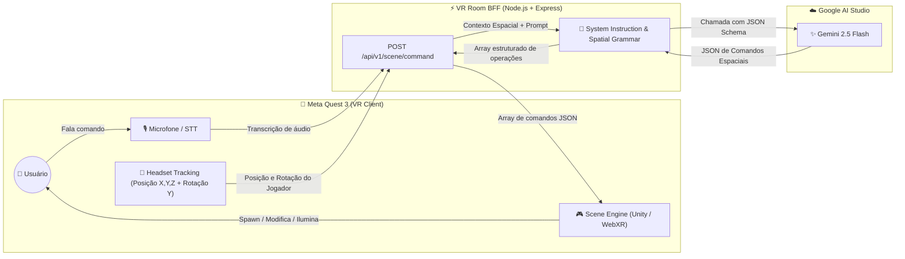

# 🥽 VR Room - Spatial AI Orchestrator

<p align="center">
  
  
  
  
  
</p>

---

## 💡 Visão Geral do Projeto

O **VR Room** é um ecossistema imersivo projetado para o **Meta Quest 3** que permite manipular, criar e transformar cenários virtuais em tempo real através de **comandos de voz naturais**. 

Em vez de menus complexos ou interfaces 2D flutuantes, o usuário simplesmente diz o que deseja (ex: *"Coloque um cavalo 3 metros à minha frente e escureça o ambiente"*), e uma IA generativa atua como o **orquestrador espacial**, traduzindo intenções humanas em uma lista determinística de ações 3D que a engine gráfica (Unity/Unreal/WebXR) executa imediatamente.

---

## 🏗️ Arquitetura do Sistema



---

## 📍 Onde Paramos & Estado Atual

### ✅ O que já está pronto e funcional:
- [x] **Backend BFF (Node.js + Express 5)** configurado, modular e servindo API + Frontend.
- [x] **Integração com Gemini API com Fallback Multi-Modelo**: Alta disponibilidade testada (`gemini-3.5-flash`, `gemini-3.7-flash`, etc.) prevenindo indisponibilidades 503.
- [x] **Memória Contextual de Cena (Scene Graph)**: Envio de `existing_objects` ao Gemini permitindo comandos contextuais contínuos (*"Aumente o cavalo em 2x"*, *"Remova o cavalo"*).
- [x] **Cliente 3D & WebXR no Navegador (`/public`)**:
  - Renderizador Three.js com PBR, sombras dinâmicas e controle de câmera.
  - Reconhecimento de voz em português via **Web Speech API** com visualizador de pulso de áudio.
  - Suporte a **WebXR** (`VRButton`) nativo para imersão no navegador do Meta Quest 3.
  - Fábrica de assets procedurais 3D (`animal_horse`, `prop_cube`, `prop_sphere`, `prop_campfire`, `env_corral`, `prop_tree`).
  - Inspetor lateral de JSON e controle de presets ambientais em tempo real.
- [x] **Script de Integração Unity C# (`/unity/VRSceneManager.cs`)**: Gerenciador de cena pronto para importação em projetos nativos do Meta Quest 3 na Unity.
- [x] **Segurança do Repositório**: `.gitignore` robusto protegendo credenciais e API keys sensíveis.

---

### ⏸️ Ponto de Parada Atual:
> **O ecossistema completo (BFF com memória + Cliente 3D WebXR no navegador + Script Unity) está rodando e validado.**  
> Você pode abrir `http://localhost:3000` agora mesmo para usar por voz no PC ou no Meta Quest Browser!

---

### 🔜 Próximos Passos (Roadmap):
- [ ] Importar `VRSceneManager.cs` em um projeto Unity completo com Meta XR SDK caso deseje compilar APK nativo.
- [ ] Adicionar suporte a WebSockets para sincronização multiplayer de múltiplos headsets na mesma sala.
- [ ] Integrar Text-to-Speech (TTS) com voz do Gemini para o ambiente responder ao usuário falando de volta.
- [ ] Validação com Schema Zod dos payloads de entrada e saída.

---

## 📡 Especificação da API

### `POST /api/v1/scene/command`

Recebe a transcrição do comando de voz e o contexto espacial do headset do usuário, retornando a lista de comandos para execução na engine VR.

#### Request Body:
```json
{
  "transcript": "Crie um cavalo a 3 metros na minha frente e um cubo à minha direita",
  "user_position": {
    "x": 0.0,
    "y": 1.75,
    "z": 2.5
  },
  "user_rotation_y": 45.0
}
```

#### Response Body:
```json
{
  "status": "ok",
  "commands": [
    {
      "op": "spawn",
      "instance_id": "cavalo_1",
      "asset_id": "animal_horse",
      "placement": {
        "mode": "relative_to_user",
        "direction": "front",
        "distance_m": 3,
        "vertical": "ground"
      }
    },
    {
      "op": "spawn",
      "instance_id": "cubo_1",
      "asset_id": "prop_cube",
      "placement": {
        "mode": "relative_to_user",
        "direction": "right",
        "distance_m": 1.5,
        "vertical": "eye_level"
      }
    }
  ]
}
```

---

## 📐 Gramática Espacial dos Comandos

| Campo | Tipo | Descrição | Valores Possíveis |
| :--- | :--- | :--- | :--- |
| `op` | `string` | **Obrigatório**. Tipo de ação a ser executada na cena | `spawn`, `modify`, `remove`, `set_environment`, `set_lighting`, `clear_scene` |
| `instance_id` | `string` | Identificador único da entidade criada ou modificada | Ex: `cavalo_1`, `mesa_centro` |
| `asset_id` | `string` | Identificador do recurso 3D correspondente no catálogo | Ex: `animal_horse`, `env_corral`, `prop_cube` |
| `placement.mode` | `string` | Referencial de coordenadas | `relative_to_user`, `absolute` |
| `placement.direction` | `string` | Direção relativa ao ângulo de visão do usuário | `front`, `back`, `left`, `right` |
| `placement.distance_m`| `number` | Distância métrica euclidiana a partir do referencial | Ex: `1.5`, `3.0`, `10` |
| `placement.vertical` | `string` | Ajuste no eixo de altura (Y) | `ground` (no chão), `eye_level` (altura dos olhos) |
| `scale.mode` | `string` | Tipo de redimensionamento | `multiply` (escala relativa), `set` (escala absoluta) |
| `scale.value` | `number` | Fator multiplicador ou valor absoluto da escala | Ex: `2.0` (dobro), `0.5` (metade) |

---

## 🚀 Como Executar Localmente

### 1. Pré-requisitos
- [Node.js](https://nodejs.org/) v18 ou superior instalado.
- Chave de API do Google Gemini ([Obtenha gratuitamente no Google AI Studio](https://aistudio.google.com/)).

### 2. Clonar e Instalar Dependências
```bash
git clone https://github.com/cszinn/vr.git
cd vr
npm install
```

### 3. Configurar Variáveis de Ambiente
Crie um arquivo `.env` a partir do template `.env.example`:
```bash
cp .env.example .env
```
Edite o arquivo `.env` e insira sua chave:
```env
GEMINI_API_KEY=sua_chave_do_gemini_aqui
PORT=3000
```

### 4. Iniciar o Servidor
```bash
npm start
```
O servidor iniciará em `http://localhost:3000`.

### 5. Testar a API (via cURL ou Postman)
```bash
curl -X POST http://localhost:3000/api/v1/scene/command \
  -H "Content-Type: application/json" \
  -d '{
    "transcript": "Coloque um cavalo na minha frente a 4 metros",
    "user_position": { "x": 0, "y": 1.7, "z": 0 },
    "user_rotation_y": 0
  }'
```

---

## 🛡️ Segurança

- As chaves de API (`GEMINI_API_KEY`) **nunca** devem ser comitadas no repositório.
- O arquivo `.env` é explicitamente ignorado pelo `.gitignore`. Sempre utilize `.env.example` para documentar novas variáveis de ambiente necessárias.

---

## 👨‍💻 Autor

- **Carlos Zinn** ([@cszinn](https://github.com/cszinn)) - *cs.off@outlook.com*
